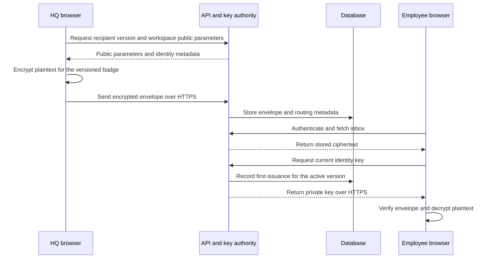

# Dispatch

[Open the deployed application](https://dispatch-ibe.sicksec.workers.dev)

An emergency directive register using Boneh–Franklin identity-based encryption on BLS12-381. Headquarters can deliver instructions to an employee before that employee has retrieved a private key. The browser encrypts the text and the API stores an encrypted envelope in SQLite.

## Project team

| Name | Roll number |
| --- | --- |
| Musawir Altaf Khan | 24I-2134 |
| Moiz Hassan | 24I-2096 |
| Abdul Rehman | 24I-2092 |

[Technical report](docs/Technical-Report.pdf) · [Presentation](docs/Presentation.pdf)

## Run on Windows, macOS or Linux

Install Node.js 24.12 or later. Extract the project into a writable folder. Open a terminal in the folder containing this README.

```sh
npm start
```

Open **http://localhost:3080**. All runtime dependencies ship with the project. On Windows, `node server.ts` also starts the app directly. Stop the server with Ctrl+C. The database and local authority key are created under `data/` on first launch. Keep this directory private and keep its contents together when moving the installation.

## First use

1. Choose **Create workspace**. Select **Save access codes** and store the resulting file privately. The workspace owner provisions a headquarters account and separate Alice and Bob accounts. Give each person their own access code privately. The three addresses are organizational identities and do not require real mailboxes.
2. Sign in as Headquarters using the populated form. Address an instruction to Alice and select **Encrypt and send** while her key still shows **Awaiting first issuance**.
3. Open a separate tab directly at the same URL. Sign in with the workspace ID, Alice’s email and her access code. Her inbox already contains the directive. Under **Inspect envelope** she can see the ciphertext. Choose **Retrieve my key**, then **Decrypt directive**.
4. Use **Export envelope** on Alice’s directive. In Bob’s tab retrieve his key, open **Open an exported envelope**, and select that same file. Bob’s key fails the cryptographic check. The same exported file opens under Alice’s matching key.
5. To test key rotation, leave Alice’s tab open, rotate her key from Headquarters, and send again. Refresh Alice’s inbox and retrieve her new key. Only the matching version opens each envelope. A freshly opened tab can only retrieve the current version.

An employee’s private key lives in tab memory and disappears on reload or sign-out. The four-hour application session survives refresh in that tab. **Refresh** reloads the inbox. Create a fresh workspace for a repeatable first-issuance sequence.

## Employee access

HQ can add a badge such as `field-17` or an employee email. Identifiers are workspace-scoped, trimmed and lowercased. Adding a badge generates a login code and leaves the private key unissued. Copy the code when displayed and distribute it privately. Send a directive before the employee's first sign-in to demonstrate IBE with a new identity.

HQ can permanently revoke an employee. The register reserves the badge, invalidates sessions and refuses login, key retrieval, rotation and new deliveries. Saved ciphertext remains readable with a matching key obtained earlier. Use rotation when an active employee needs a new key version.

## Directive delivery and key issuance



If HQ rotates the key after another tab has composed a directive, the server compares the submitted version during the database write. It rejects a stale send with HTTP 409. Refresh the recipient and encrypt again for the new version.

## Verification

```sh
npm test
npm run measure
```

The tests run actual application handlers, cryptography and SQLite in an isolated temporary directory. They cover delivery before key issuance, correct and wrong keys, tampering, role and tenant separation, database reopen, rotation and logout. The measurement script reports median encryption/decryption time and serialized envelope bytes.

## Code and records

| File | Responsibility |
| --- | --- |
| server.ts | Node HTTP adapter, bounded requests, static assets and response security headers |
| api.js | REST routes, role checks, workspace setup, key authority and atomic database operations |
| database.ts, schema.sql | SQLite initialization, transactions, constraints, indexes and persistent authority configuration |
| public/ibe.js | Boneh–Franklin FullIdent construction, domain separation and Web Crypto AES-256-GCM |
| public/app.js | Sign-in, sending, inbox, file import/export, identity key retrieval and rotation |
| public/vendor | Browser-ready Noble curve and hashing modules, distributed under their included MIT licenses |
| docs | Technical report and presentation |

### REST endpoints

| Method and path | Who | Result |
| --- | --- | --- |
| POST /api/workspaces | Workspace creator | Separate register, public parameters and one-time display of access codes |
| POST /api/login | Account holder | Expiring random bearer token |
| GET /api/state | Signed-in account | Role-filtered inbox or sent register, newest 100 entries |
| POST /api/directives | Headquarters | Store a validated encrypted envelope for the recipient’s current version |
| POST /api/keys | Employee | Extract the signed-in identity’s current private key |
| POST /api/employees | Headquarters | Provision a fresh employee badge and login code |
| POST /api/revoke | Headquarters | Permanently disable an employee and invalidate sessions |
| POST /api/rotate | Headquarters | Advance the recipient’s version and clear its issuance timestamp |
| POST /api/logout | Signed-in account | Invalidate the token |

### SQL inspection

Open `data/dispatch.sqlite` in a SQLite viewer. The following is a read-only query you can explain in class. The first issuance time belongs to the account’s **current** key version.

```sql
SELECT d.id, d.recipient, d.version, d.created_at, a.issued_at
FROM directives AS d
JOIN accounts AS a
  ON a.workspace = d.workspace AND a.email = d.recipient
WHERE d.version = a.version
ORDER BY d.created_at DESC;
```

## Deployment

For the deployed Cloudflare Worker, install the locked build dependencies with `npm ci`, run `node scripts/build-worker.cjs`, apply D1 migrations with `npx wrangler d1 migrations apply DB --remote`, and deploy with `npx wrangler deploy`. Configure the stable MASTER_KEY as a Worker secret. For a separate installation, create your own D1 database and set its ID in wrangler.jsonc.

**Docker on a local machine:** run `docker compose up --build` and open the same localhost URL. The named volume preserves the database and authority key across container replacements.

**Public hosting:** run the included Dockerfile on a service with an HTTPS endpoint and a persistent volume mounted at `/var/lib/dispatch`. Set the listening port to match the host configuration. The Dockerfile already binds to all interfaces. Run one instance per SQLite volume. A free ephemeral filesystem loses accounts and directives on replacement. A single-container deployment with a durable volume, or the included Worker adapter with a managed SQLite D1 binding, preserves records. Secure browser cryptography requires HTTPS or localhost.

For the Worker adapter, supply a D1 binding named `DB`, apply the SQL migrations under `drizzle/` in numerical order, and configure a stable secret `MASTER_KEY` of 32 random bytes encoded as 64 lowercase hex characters. To bundle it, install TypeScript 6.0.3 as a build tool, then run `node scripts/build-worker.cjs`. The resulting `dist/server/index.js` exports the Worker entry point. Local Node execution requires no build step.

**Backup:** stop the local server and back up the entire data directory. Protect that backup as a key authority. A database-only backup cannot restore decryption capability without the corresponding authority secret. Never commit runtime keys, generated workspace access packets or user data.

## Security boundaries

The key authority can derive every identity key in its workspace. The application host serves browser code and must be trusted. Workspace creation grants the creator provisioning access to all three accounts. Identity verification in this application uses separately distributed, randomly generated access codes. An institutional deployment would connect employee provisioning to an authenticated directory. The server sees recipient, time, version and ciphertext length. Rotating a key protects subsequent directives. It cannot erase previously disclosed keys or plaintext. The application protocol has not received an independent cryptographic audit.

## Implementation references

- Boneh and Franklin, *Identity-Based Encryption from the Weil Pairing*: https://crypto.stanford.edu/~dabo/papers/bfibe.pdf
- IBE architecture and key authority: https://www.rfc-editor.org/rfc/rfc5408
- Hash to curve: https://www.rfc-editor.org/rfc/rfc9380
- Curve arithmetic and pairings: https://github.com/paulmillr/noble-curves/tree/1.9.7
- Hash functions: https://github.com/paulmillr/noble-hashes/tree/1.8.0

The included Noble modules were transpiled from the named upstream release tags with relative ESM imports for offline operation. The application uses a versioned Type-3 pairing adaptation and its own envelope encoding. Interoperability with RFC 5091 wire formats is outside its scope.

